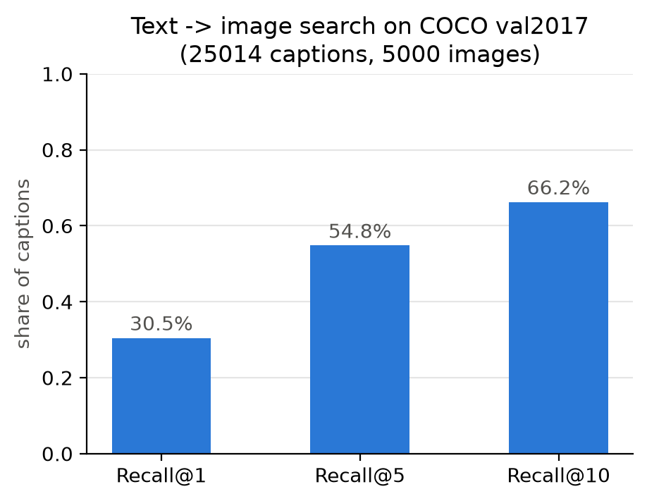

# CLIP Image Search

Text-to-image and image-to-image search over 5,000 COCO photos with CLIP, evaluated with Recall@K and deployed as an in-browser demo.

**Live demo: https://mengyi-an.github.io/image-classifier/#search**

Type a description such as "a dog on the beach", or upload a photo, to get the most similar images. Click any result to see photos similar to it. The demo is the "Image search" tab of my [image classifier](https://github.com/Mengyi-An/image-classifier) page. CLIP runs in your browser with Transformers.js, so no server is needed.

## What This Project Does

- **Data:** COCO 2017 validation set, 5,000 photos with about 5 human-written captions each (25,014 captions)
- **Model:** pretrained CLIP ViT-B/32, which maps images and texts into the same 512-dim vector space. No training: the project only runs inference.
- **Search:** every photo is encoded once; a query is encoded at search time and compared with all photos by cosine similarity
- **Evaluation:** each caption is used as a query, and Recall@K measures how often its own photo is in the top K of the 5,000
- **Comparison experiment:** plain CLIP vectors vs centered vectors (see below)
- **Browser demo:** image vectors are computed in Python and exported to GitHub Pages; queries are encoded in the browser with the same model

## Results

| Vectors | Recall@1 | Recall@5 | Recall@10 |
|---|---|---|---|
| plain CLIP | 30.5% | 54.8% | **66.2%** |
| **centered** | **30.9%** | **55.3%** | **66.2%** |



- **The right photo is the top match for about 1 in 3 captions, and in the top 10 for 2 in 3**, out of 5,000 photos and without any training on COCO.
- **Centering gives a small, free improvement.** Image vectors and text vectors sit in two different regions of CLIP's space. Subtracting each one's own mean (the image mean from image vectors, the text mean from text vectors) and normalizing again raises Recall@1 and Recall@5 by about 0.5 points.
- **Centering only one side hurts.** Subtracting the image mean from the image vectors alone lowered Recall@1 to 26.4%, because it moves the two sides further apart.
- **A larger gallery mattered more than centering for the demo.** With only 1,000 photos, a few "hub" photos that are close to almost everything filled the lower result slots. With all 5,000, there are enough truly relevant photos to fill them.


## How the Search Works

```
offline (Python):  5,000 photos -> CLIP image encoder -> vectors -> subtract image mean -> normalize
search time:       text  -> CLIP text encoder  -> subtract text mean  -> normalize ┐
                   image -> CLIP image encoder -> subtract image mean -> normalize ┴-> dot product with every photo -> top K
```

All vectors have length 1, so the dot product is the cosine similarity. Clicking a result needs no model at all: that photo's vector is already in the gallery.

The browser demo uses `Xenova/clip-vit-base-patch32`, the same CLIP weights converted to ONNX, with 8-bit quantization (about 65 MB for the text encoder and 90 MB for the image encoder, which is loaded only on the first upload). Quantization changes the vectors slightly, so the order of results with very close scores can differ from Python.

## Project Structure

```
src/
  data.py          download COCO val2017, read image paths and captions
  model.py         load CLIP, encode images and texts into normalized vectors
  embed.py         encode all photos and captions once, centering helpers
  search.py        text -> images and image -> images from the command line
  evaluate.py      Recall@K, plain vs centered -> data/metrics.json
  plot.py          figures/recall.png and figures/search_examples.png
  export_demo.py   thumbnails, vectors and means for the browser demo
figures/           result plots
```

The web page itself lives in the [image-classifier](https://github.com/Mengyi-An/image-classifier) repository (`docs/search.js`, `docs/search/`).

## How to Run

Install the dependencies (Python 3.11):

```bash
pip install -r requirements.txt
```

Then run the steps in order:

```bash
python -m src.data          # download COCO val2017 (~1 GB) and print statistics
python -m src.embed         # encode 5,000 photos and 25,014 captions (a few minutes)
python -m src.evaluate      # Recall@K, plain vs centered -> data/metrics.json
python -m src.plot          # -> figures/
python -m src.search "a dog on the beach"     # or: python -m src.search path/to/photo.jpg
python -m src.export_demo   # -> ../image-classifier/docs/search/
```

CLIP is downloaded from the Hugging Face Hub on the first run. Everything runs on a laptop CPU or Apple GPU; no Colab is needed. `export_demo` expects the image-classifier repository to be cloned next to this one.
