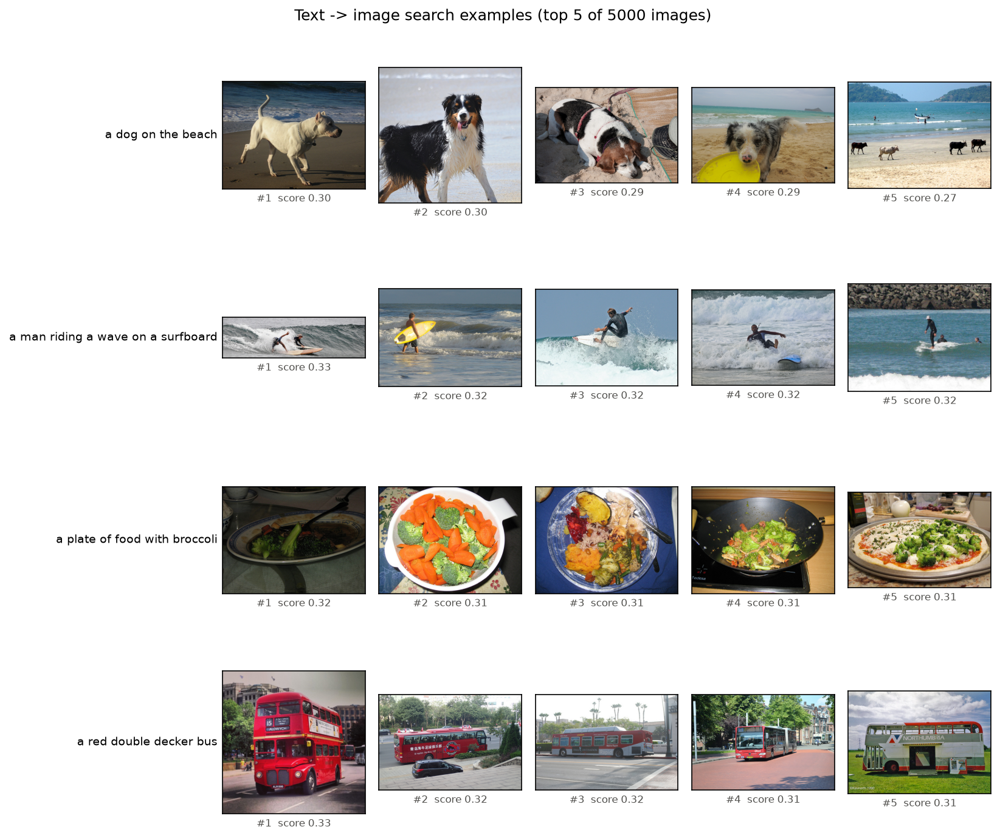

# CLIP Image Search

Text-to-image and image-to-image search over 5,000 COCO photos with CLIP, evaluated with Recall@K and running in the browser.

**Live demo: https://mengyi-an.github.io/image-classifier/#search**

Type a description or upload a photo to find the most similar images, and click a result to see similar photos. The demo is a tab of my [image classifier](https://github.com/Mengyi-An/image-classifier) page.

## Results

| Vectors            | Recall@1        | Recall@5        | Recall@10       |
| ------------------ | --------------- | --------------- | --------------- |
| plain              | 30.5%           | 54.8%           | 66.2%           |
| **centered** | **30.9%** | **55.3%** | **66.2%** |


- Out of 5,000 photos, the right one is the top match for about 1 in 3 captions, and in the top 10 for 2 in 3.
- Centering (subtracting the image mean from image vectors and the text mean from text vectors) gives a small improvement.



## Project Structure

```
src/
  data.py          download COCO and read captions
  model.py         load CLIP, encode images and texts
  embed.py         encode all photos and captions once
  search.py        search from the command line
  evaluate.py      Recall@K, plain vs centered
  plot.py          result plots
  export_demo.py   export files for the browser demo
figures/           result plots
```

## Usage

```bash
pip install -r requirements.txt

python -m src.data          # download COCO val2017 (~1 GB)
python -m src.embed         # encode photos and captions
python -m src.evaluate      # data/metrics.json
python -m src.plot          # figures
python -m src.search "a dog on the beach"
python -m src.export_demo   # -> ../image-classifier/docs/search/
```
